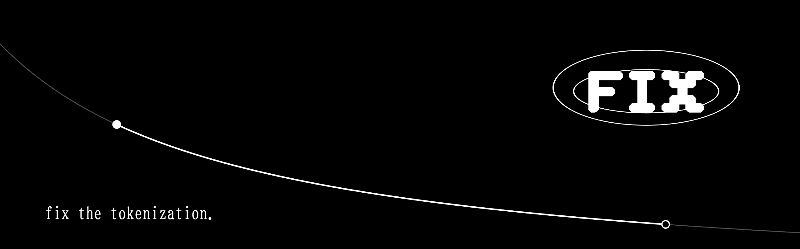
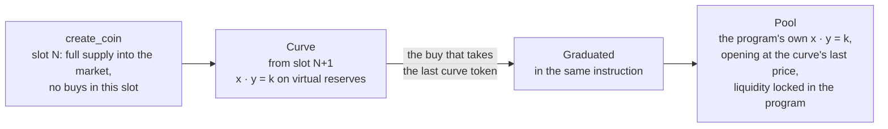
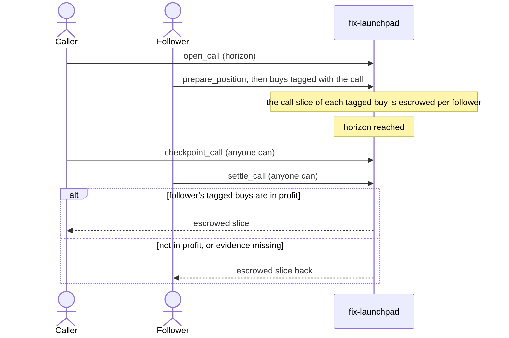

<p align="center">
  
</p>

<p align="center">
  <a href="https://fixtheonchain.com">fixtheonchain.com</a>
</p>

# fix-launchpad

The Solana program behind fix. A coin is created with its whole supply in its market, trades on a constant-product
curve from the slot after its creation, and graduates into the program's own pool in the same instruction that buys
the last curve token. Every trade pays one fee that is fixed for the coin's whole life and itemized in a receipt, and
callers are paid only when the people who followed their call came out ahead.

Anchor 0.31.1 · Token-2022 · 17 instructions · 19 LiteSVM money tests

## A coin's life



- **Creation.** `create_coin` mints a Token-2022 coin with on-mint metadata and sends the whole supply to its market.
  There is no creator allocation and no remaining mint or freeze authority. The market records `created_slot`.
- **No block-0 buys.** Every buy requires `Clock.slot > created_slot` and otherwise fails with `BuyNotOpen`. That
  covers the creation transaction, bundles and separate transactions in the same slot, for the creator and everyone
  else. Buying opens at `created_slot + 1`, with no delay setting and no keeper.
- **Graduation without a migration.** The curve's reserves become the pool's reserves in the same instruction, with no
  new accounts, migration fee, LP token or withdrawal path. Effective pool reserves keep the exact final curve price.

## One fee, fixed per coin

- The fee terms (rate per phase and the split) are copied into the coin at creation and never change for that coin.
- One total fee per trade, split between protocol, creator, a call slice and a share that stays in the pool. Protocol
  and pool shares round down and the creator receives the remainder.
- Every trade emits an itemized `Receipt`: `gross`, `protocol_fee`, `creator_fee`, `call_fee`, `pool_fee`, `net`,
  `tokens`, `refund`, `price_before`, `price_after` and `price_impact_bps`. Quotes match execution exactly.
- Following a call costs the same as trading without one: the call slice comes out of the protocol's share.
- Protocol fees accrue to the PDA seeded `protocol`, which has no withdrawal instruction.

## Calls with outcome-linked payout



- Tagged buys are scored at a time-weighted average exit price, net of the sell fee, over a window that ends at the
  horizon. The market keeps a fixed 241-entry ring of minute-boundary price integrals (`PriceHistory`, 9,704 bytes),
  so a last-second pump cannot rewrite the time before it.
- The mark must strictly exceed the tagged cost; break-even refunds the follower.
- Settlement is permissionless, a caller cannot follow their own call, and a settled position cannot pay twice.
- Positions and calls close back to the accounts that paid their rent.

## Instructions

| Group | Instructions |
| --- | --- |
| Config | `initialize_config(terms)`, `update_config(terms, paused)`, `propose_admin(new_admin)`, `accept_admin` |
| Coins and trading | `create_coin(name, symbol, uri, expected_config_revision)`, `buy_exact_in(gross, min_tokens)`, `buy_exact_out(tokens, max_gross)`, `sell_exact_in(tokens, min_sol)`, `sell_exact_out(sol, max_tokens)`, `claim_creator_fees` |
| Calls | `open_call(id, horizon_seconds)`, `prepare_position`, `checkpoint_call`, `settle_call`, `claim_call_payout`, `close_call`, `close_position` |

Config updates and pause apply to coins created from then on. No admin instruction touches a live coin's market,
fees or funds.

## Accounts

| Account | Seeds | Holds |
| --- | --- | --- |
| `Config` | `["config"]` | Admin, pending admin, pause flag, revision, the terms new coins copy |
| `Protocol` | `["protocol"]` | Accrued protocol fees |
| `Market` | `["market", mint]` | Mint, creator, the coin's locked terms, phase, curve and pool reserves, creator fees, receipt sequence, price accumulator, `created_slot` |
| vault | `["vault", market]` | The market's Token-2022 token account |
| `PriceHistory` | `["prices", market]` | 241 minute-boundary price integrals (zero-copy) |
| `CallerSequence` | `["call-sequence", market, caller]` | The caller's next call id on this market |
| `Call` | `["call", market, caller, id (u64 LE)]` | Window start, horizon, frozen price integral, follower and settlement counts, earned, refunded, held payout |
| `CallPosition` | `["position", call, follower]` | A follower's tagged cost and tokens, escrowed slice, settlement result, rent payer |

Terms: `total_supply`, `decimals`, `virtual_sol`, `virtual_token`, `curve_tokens`, `curve_fee_bps`, `pool_fee_bps`,
`protocol_share_bps`, `creator_share_bps`, `pool_share_bps`, `call_share_bps`, `min_horizon`, `max_horizon`,
`scoring_window`.

Events: `CoinCreated`, `Receipt`, `Graduated`, `PriceRecorded`, `CallOpened`, `CallCheckpointed`, `CallSettled`,
`CallPayoutClaimed`, `CallClosed`, `PositionClosed`. The full interface is in [`idl/fix_launchpad.json`](idl/fix_launchpad.json).

## Layout

| Path | Contents |
| --- | --- |
| [`programs/fix-launchpad/src/lib.rs`](programs/fix-launchpad/src/lib.rs) | Instructions and their handlers |
| [`programs/fix-launchpad/src/contexts.rs`](programs/fix-launchpad/src/contexts.rs) | Account constraints and PDAs |
| [`programs/fix-launchpad/src/state.rs`](programs/fix-launchpad/src/state.rs) | Accounts, terms, events, errors |
| [`programs/fix-launchpad/src/math.rs`](programs/fix-launchpad/src/math.rs) | Integer curve, pool and fee math |
| [`programs/fix-launchpad/src/oracle.rs`](programs/fix-launchpad/src/oracle.rs) | The minute-boundary price ring and window integrals |
| [`programs/fix-launchpad/tests/money.rs`](programs/fix-launchpad/tests/money.rs) | LiteSVM tests against the built SBF binary |
| [`idl/fix_launchpad.json`](idl/fix_launchpad.json) | Anchor IDL |
| [`docs/decisions.md`](docs/decisions.md) | Arithmetic, rounding, price record and rent decisions |

## Build and test

Rust with the Solana SBF toolchain (`cargo-build-sbf`) and Anchor 0.31.1 for the IDL.

```bash
cargo-build-sbf --manifest-path programs/fix-launchpad/Cargo.toml --arch v0
```

```bash
cargo test -p fix-launchpad --test money -- --test-threads=1
```

```bash
anchor idl build --out idl/fix_launchpad.json
```

The tests load `target/deploy/fix_launchpad.so` into LiteSVM and set its clock directly, so no validator runs. They
cover:

- creation with the fixed supply and no purchase, and a prefunded mint or vault not blocking creation
- create-and-buy in one transaction failing for every buyer and buy mode, and same-slot buys failing for every buyer,
  mode and tag, then next-slot buys matching the math exactly
- quotes, fees, graduation and the pool in all four trade modes, exact fee splits and the inverse fee at the u64 edge
- call profit paying the caller once, call loss refunding the follower, a last-second pump not flipping the result,
  and exact break-even refunding
- minute boundaries reconstructed across quiet minutes and price changes within a minute, a checkpoint surviving ring
  overwrite and late followers, an overwritten window refunding without waiting, and the maximum scoring window keeping
  two hours of checkpoint margin
- caller sequences that other callers cannot race, more than sixteen calls adding no accounts to a trade, an unfunded
  caller not blocking the follower's rent with deferred payouts claimable, and unused positions and completed calls
  returning their rent
- extreme curve trades with receipt impact saturating instead of reverting

The program id in `declare_id!` and `Anchor.toml` is the local development id.
