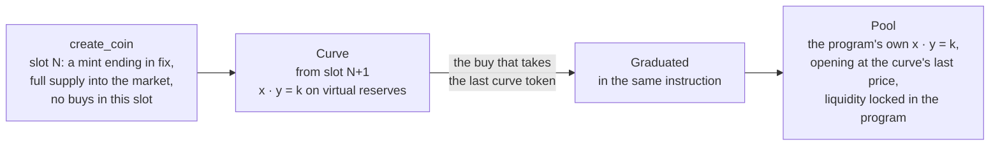
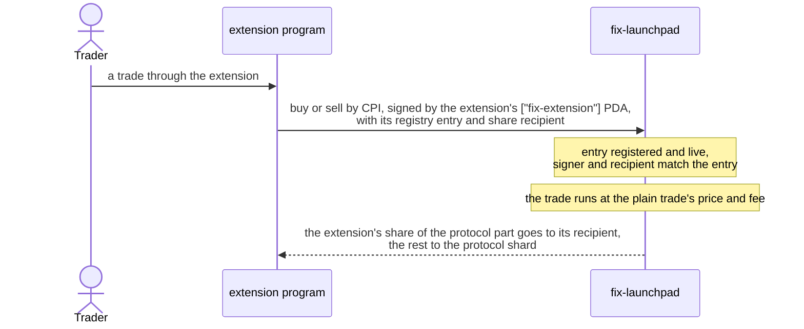

<p align="center">
  
</p>

<p align="center">
  <a href="https://fixtheonchain.com">fixtheonchain.com</a>
</p>

# fix-launchpad

The Solana program behind fix. A coin is created with its whole supply in its market, trades on a constant-product
curve from the slot after its creation, and graduates into the program's own pool in the same instruction that buys
the last curve token. Every trade pays one fee that is fixed for the coin's whole life and itemized in a receipt.
Features ship as extensions: separate programs that route trades into this one by CPI, registered without an upgrade
of the core. Calls arrive as the first extension.

Anchor 0.31.1 · Token-2022 · 14 instructions · 14 LiteSVM money tests

## A coin's life



- **Creation.** `create_coin` mints a Token-2022 coin with on-mint metadata and sends the whole supply to its market.
  The mint's base58 address ends in `fix`, checked on chain in 312 CU (`InvalidMintSuffix` otherwise). There is no
  creator allocation and no remaining mint or freeze authority. The market records `created_slot`.
- **No block-0 buys.** Every buy requires `Clock.slot > created_slot` and otherwise fails with `BuyNotOpen`. That
  covers the creation transaction, bundles and separate transactions in the same slot, for the creator and everyone
  else. Buying opens at `created_slot + 1`, with no delay setting and no keeper.
- **Graduation without a migration.** The curve's reserves become the pool's reserves in the same instruction, with no
  new accounts, migration fee, LP token or withdrawal path. Effective pool reserves keep the exact final curve price.

## One fee, fixed per coin

- The fee terms (rate per phase and the split) are copied into the coin at creation and never change for that coin.
- One total fee per trade, split between protocol, creator and a share that stays in the pool. Protocol and pool
  shares round down and the creator receives the remainder.
- Every trade, claim and graduation emits an itemized `Receipt`: `gross`, `protocol_fee`, `creator_fee`, `pool_fee`,
  `net`, `tokens`, `refund`, `price_before`, `price_after`, `price_impact_bps`, `extension` and `extension_fee`.
  Quotes match execution exactly.
- Protocol fees accrue to 64 PDAs seeded `["protocol", shard]`, credited in the instruction that charges them, so
  markets share no write lock. There is no withdrawal instruction.

## Extensions



- The admin registers, pauses and removes an extension without a core upgrade. Each has one `Extension` PDA keyed by
  its program id, naming its signing PDA, its share recipient and its share of the protocol part of the fee, in bps of
  that part.
- A routed trade passes exactly three remaining accounts: the registry entry, the extension's `["fix-extension"]` PDA
  as signer, and the recipient. Only the extension program can sign as that PDA, so the trade is proven to come from it.
- The trader's cost, quotes, the creator's share, the pool's share and the coin's terms are those of a plain trade.
  Receipts name the extension and its fee line.
- Plain trades never read the registry. Pausing or removing an extension stops only its new routed trades.
- The core never calls out to another program except Token-2022, the System program and its own event CPI.

## Instructions

| Group | Instructions |
| --- | --- |
| Config | `initialize_config(terms)`, `update_config(terms, paused)`, `propose_admin(new_admin)`, `accept_admin`, `create_protocol_shard(shard)` |
| Extensions | `register_extension(program_id, share_bps, recipient)`, `set_extension_paused(paused)`, `remove_extension` |
| Coins and trading | `create_coin(name, symbol, uri, expected_config_revision)`, `buy_exact_in(gross, min_tokens)`, `buy_exact_out(tokens, max_gross)`, `sell_exact_in(tokens, min_sol)`, `sell_exact_out(sol, max_tokens)`, `claim_creator_fees` |

Config updates and pause apply to coins created from then on. No admin instruction touches a live coin's market,
fees or funds.

## Accounts

| Account | Seeds | Holds |
| --- | --- | --- |
| `Config` | `["config"]` | Revision, admin, pending admin, pause flag, the terms new coins copy |
| `Protocol` | `["protocol", shard]`, shard 0–63 | Accrued protocol fees |
| `Market` | `["market", mint]` | Mint, creator, the coin's locked terms, phase, curve and pool reserves, burned tokens, creator fees, receipt sequence, `created_slot` |
| vault | `["vault", market]` | The market's Token-2022 token account |
| `Extension` | `["extension", program_id]` | The extension's program, signing PDA, share recipient, share in bps of the protocol part, pause flag |
| event authority | `["__event_authority"]` | Signs the self-CPIs that carry events |

Terms: `total_supply`, `decimals`, `virtual_sol`, `virtual_token`, `curve_tokens`, `curve_fee_bps`, `pool_fee_bps`,
`protocol_share_bps`, `creator_share_bps`, `pool_share_bps`. The launch terms are in
[`scripts/mainnet-terms.json`](scripts/mainnet-terms.json).

Events: `CoinCreated`, `Receipt` and `Graduated`, emitted through Anchor's `#[event_cpi]` so they travel as
inner-instruction data, which the runtime records in full. The full interface is in
[`idl/fix_launchpad.json`](idl/fix_launchpad.json).

## Layout

| Path | Contents |
| --- | --- |
| [`programs/fix-launchpad/src/lib.rs`](programs/fix-launchpad/src/lib.rs) | Instructions, routing and their handlers |
| [`programs/fix-launchpad/src/contexts.rs`](programs/fix-launchpad/src/contexts.rs) | Account constraints and PDAs |
| [`programs/fix-launchpad/src/state.rs`](programs/fix-launchpad/src/state.rs) | Accounts, terms, events |
| [`programs/fix-launchpad/src/math.rs`](programs/fix-launchpad/src/math.rs) | Integer curve, pool and fee math |
| [`programs/fix-launchpad/src/vanity.rs`](programs/fix-launchpad/src/vanity.rs) | The `fix` mint suffix check |
| [`programs/fix-launchpad/tests/money.rs`](programs/fix-launchpad/tests/money.rs) | LiteSVM tests against the built SBF binaries |
| [`programs/fix-test-extension/`](programs/fix-test-extension/) | A test-only extension the money tests route trades through |
| [`idl/fix_launchpad.json`](idl/fix_launchpad.json) | Anchor IDL |
| [`scripts/mainnet-terms.json`](scripts/mainnet-terms.json) | Launch terms for `initialize_config` |
| [`docs/decisions.md`](docs/decisions.md) | Arithmetic, rounding, extension, event and rent decisions |

## Build and test

Rust with the Solana SBF toolchain (`cargo-build-sbf`) and Anchor 0.31.1 for the IDL.

```bash
cargo-build-sbf --manifest-path programs/fix-launchpad/Cargo.toml --arch v0
```

```bash
cargo-build-sbf --manifest-path programs/fix-test-extension/Cargo.toml --arch v0
```

```bash
cargo test -p fix-launchpad --test money -- --test-threads=1
```

```bash
anchor idl build -o idl/fix_launchpad.json
```

The deployed program is built reproducibly with [`solana-verify`](https://github.com/solana-foundation/solana-verifiable-build)
in the Solana Foundation's build image, so anyone can rebuild this repository and compare the result with the program
on chain:

```bash
solana-verify build --library-name fix_launchpad --base-image solanafoundation/solana-verifiable-build:3.1.14
```

```bash
solana-verify get-executable-hash target/deploy/fix_launchpad.so
```

The tests load `target/deploy/fix_launchpad.so` and the test extension into LiteSVM and set the clock directly, so no
validator runs. They cover:

- creation with the fixed supply and no purchase, a prefunded mint or vault not blocking creation, and mints without
  the `fix` suffix refused with no funds kept
- the suffix derivation checked against real base58 encodings
- create-and-buy in one transaction failing for every buyer and buy mode, and same-slot buys failing for every buyer
  and mode, then next-slot buys matching the math exactly
- quotes, fees, graduation and the pool in all four trade modes, exact fee splits and the inverse fee at the u64 edge
- trades routed through the test extension in all four modes against an identical plain market: the trader, creator
  and pool lines match, `protocol_fee + extension_fee` equals the plain protocol line, and the recipient gains
  exactly `extension_fee`
- each extension refusal by name, and plain trades unchanged after an entry is paused or removed
- transactions of 4, 8, 12 and 16 buys keeping every receipt, including one whose logs pass the 10,000-byte budget,
  and a coin created after 40 Memo instructions keeping its `CoinCreated`
- compute units per action under the launch terms, and extreme curve trades with receipt impact saturating instead of
  reverting

The program id in `declare_id!` and `Anchor.toml` is the mainnet program id,
`14pdiXAQsKiLDr29KxV4FNRLe14JjUVwQwTCz7BZSfix`.

## License

Apache License 2.0, in [LICENSE](LICENSE).
