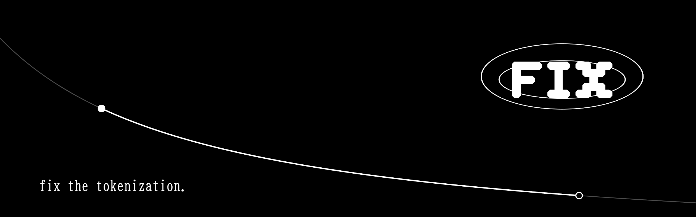
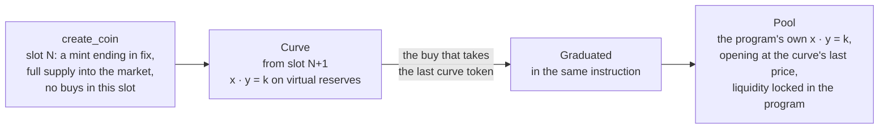
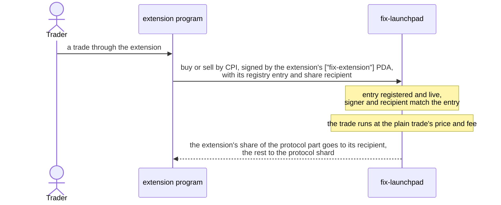
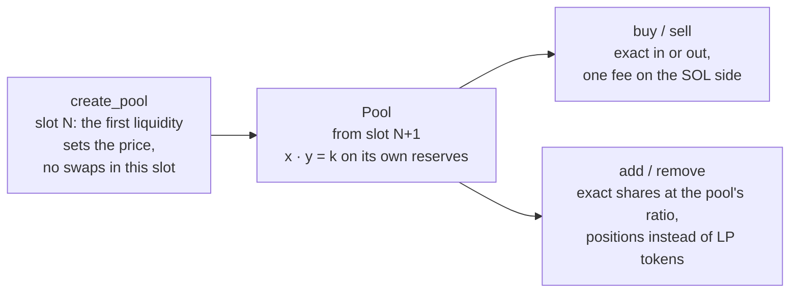

<p align="center">
  
</p>

<p align="center">
  <a href="https://fixtheonchain.com">fixtheonchain.com</a>
</p>

# fix-launchpad

The Solana programs behind fix: the launchpad, and the fix AMM ([below](#fix-amm)). The launchpad is described
first. A coin is created with its whole supply in its market, trades on a constant-product
curve from the slot after its creation, and graduates into the program's own pool in the same instruction that buys
the last curve token. Every trade pays one fee that is fixed for the coin's whole life and itemized in a receipt.
Features ship as extensions: separate programs that route trades into this one by CPI, registered without an upgrade
of the core. Calls arrive as the first extension.

Anchor 0.31.1 · Token-2022 · 14 instructions · 14 LiteSVM money tests

## A coin's life



- **Creation.** `create_coin` mints a Token-2022 coin with on-mint metadata and sends the whole supply to its market.
  The mint's base58 address ends in `fix`, checked on chain in 312 CU (`InvalidMintSuffix` otherwise). There is no
  creator allocation and no remaining mint or freeze authority. The market records `created_slot`.
- **No block-0 buys.** Every buy requires `Clock.slot > created_slot` and otherwise fails with `BuyNotOpen`. That
  covers the creation transaction, bundles and separate transactions in the same slot, for the creator and everyone
  else. Buying opens at `created_slot + 1`, with no delay setting and no keeper.
- **Graduation without a migration.** The curve's reserves become the pool's reserves in the same instruction, with no
  new accounts, migration fee, LP token or withdrawal path. Effective pool reserves keep the exact final curve price.

## One fee, fixed per coin

- The fee terms (rate per phase and the split) are copied into the coin at creation and never change for that coin.
- One total fee per trade, split between protocol, creator and a share that stays in the pool. Protocol and pool
  shares round down and the creator receives the remainder.
- Every trade, claim and graduation emits an itemized `ReceiptV2`: `gross`, `protocol_fee`, `creator_fee`, `pool_fee`,
  `net`, `tokens`, `refund`, `price_before`, `price_after`, `price_impact_bps`, `extension`, `extension_fee`,
  `snipe_fee` and `extra_fee`. Transactions from before the anti-sniping upgrade carry the first layout, `Receipt`.
  Quotes match execution exactly; a buy that lands after its quoted slot can only pay the same rate or less.
- Protocol fees accrue to 64 PDAs seeded `["protocol", shard]`, credited in the instruction that charges them, so
  markets share no write lock. There is no withdrawal instruction.

## Anti-sniping

A coin created since the anti-sniping upgrade carries a schedule in its terms. A buy in the coin's first tradable
slot pays `start_bps`; the rate falls in `steps` equal steps of `step_slots` slots each, down to the coin's own rate.
Every buyer in the same slot pays the same rate, sells always pay the coin's own rate, and the part above the coin's
own rate goes to the pool line, so it stays in the coin's reserves and raises its price for every holder. The receipt
names that part (`snipe_fee`). Launch schedule: 25% in the first tradable slot, falling every 10 slots to the coin's
own rate after 150 slots ([`scripts/launch-terms.json`](scripts/launch-terms.json)).

## Extensions



- The admin registers, pauses and removes an extension without a core upgrade. Each has one `Extension` PDA keyed by
  its program id, naming its signing PDA, its share recipient and its share of the protocol part of the fee, in bps of
  that part.
- A routed trade passes exactly three remaining accounts: the registry entry, the extension's `["fix-extension"]` PDA
  as signer, and the recipient. Only the extension program can sign as that PDA, so the trade is proven to come from it.
- The trader's cost, quotes, the creator's share, the pool's share and the coin's terms are those of a plain trade.
  Receipts name the extension and its fee line.
- Plain trades never read the registry. Pausing or removing an extension stops only its new routed trades.
- The core never calls out to another program except Token-2022, the System program and its own event CPI.

## Instructions

| Group | Instructions |
| --- | --- |
| Config | `initialize_config(terms)`, `update_config(terms, paused)`, `set_snipe(snipe)`, `propose_admin(new_admin)`, `accept_admin`, `create_protocol_shard(shard)` |
| Extensions | `register_extension(program_id, share_bps, recipient)`, `set_extension_paused(paused)`, `remove_extension` |
| Coins and trading | `create_coin(name, symbol, uri, expected_config_revision)`, `buy_exact_in(gross, min_tokens)`, `buy_exact_out(tokens, max_gross)`, `sell_exact_in(tokens, min_sol)`, `sell_exact_out(sol, max_tokens)`, `claim_creator_fees` |

Config updates and pause apply to coins created from then on. No admin instruction touches a live coin's market,
fees or funds.

## Accounts

| Account | Seeds | Holds |
| --- | --- | --- |
| `Config` | `["config"]` | Revision, admin, pending admin, pause flag, the terms new coins copy; after them, the anti-sniping schedule (`ConfigExt`) |
| `Protocol` | `["protocol", shard]`, shard 0–63 | Accrued protocol fees |
| `Market` | `["market", mint]` | Mint, creator, the coin's locked terms, phase, curve and pool reserves, burned tokens, creator fees, receipt sequence, `created_slot`; after them, 32 bytes of later terms (`MarketExt`: the schedule, the launch type, the extra fee), all zero on coins created before |
| vault | `["vault", market]` | The market's Token-2022 token account |
| `Extension` | `["extension", program_id]` | The extension's program, signing PDA, share recipient, share in bps of the protocol part, pause flag |
| event authority | `["__event_authority"]` | Signs the self-CPIs that carry events |

Terms: `total_supply`, `decimals`, `virtual_sol`, `virtual_token`, `curve_tokens`, `curve_fee_bps`, `pool_fee_bps`,
`protocol_share_bps`, `creator_share_bps`, `pool_share_bps`. The launch terms are in
[`scripts/mainnet-terms.json`](scripts/mainnet-terms.json).

Events: `CoinCreated`, `ReceiptV2` (`Receipt` before the anti-sniping upgrade) and `Graduated`, emitted through Anchor's `#[event_cpi]` so they travel as
inner-instruction data, which the runtime records in full. The full interface is in
[`idl/fix_launchpad.json`](idl/fix_launchpad.json).

## Layout

| Path | Contents |
| --- | --- |
| [`programs/fix-launchpad/src/lib.rs`](programs/fix-launchpad/src/lib.rs) | Instructions, routing and their handlers |
| [`programs/fix-launchpad/src/contexts.rs`](programs/fix-launchpad/src/contexts.rs) | Account constraints and PDAs |
| [`programs/fix-launchpad/src/state.rs`](programs/fix-launchpad/src/state.rs) | Accounts, terms, events |
| [`programs/fix-launchpad/src/math.rs`](programs/fix-launchpad/src/math.rs) | Integer curve, pool and fee math |
| [`programs/fix-launchpad/src/vanity.rs`](programs/fix-launchpad/src/vanity.rs) | The `fix` mint suffix check |
| [`programs/fix-launchpad/tests/money.rs`](programs/fix-launchpad/tests/money.rs) | LiteSVM tests against the built SBF binaries |
| [`programs/fix-test-extension/`](programs/fix-test-extension/) | A test-only extension the money tests route trades through |
| [`programs/fix-test-hook/`](programs/fix-test-hook/) | A test-only hook the AMM's money tests open hooked pools and pairs with |
| [`idl/fix_launchpad.json`](idl/fix_launchpad.json) | Anchor IDL |
| [`scripts/mainnet-terms.json`](scripts/mainnet-terms.json) | Launch terms for `initialize_config` |
| [`docs/decisions.md`](docs/decisions.md) | Arithmetic, rounding, extension, event and rent decisions |

## Build and test

Rust with the Solana SBF toolchain (`cargo-build-sbf`) and Anchor 0.31.1 for the IDL.

```bash
cargo-build-sbf --manifest-path programs/fix-launchpad/Cargo.toml --arch v0
```

```bash
cargo-build-sbf --manifest-path programs/fix-test-extension/Cargo.toml --arch v0
```

```bash
cargo test -p fix-launchpad --test money -- --test-threads=1
```

```bash
anchor idl build -o idl/fix_launchpad.json
```

The deployed program is built reproducibly with [`solana-verify`](https://github.com/solana-foundation/solana-verifiable-build)
in the Solana Foundation's build image, so anyone can rebuild this repository and compare the result with the program
on chain:

```bash
solana-verify build --library-name fix_launchpad --base-image solanafoundation/solana-verifiable-build:3.1.14
```

```bash
solana-verify get-executable-hash target/deploy/fix_launchpad.so
```

The tests load `target/deploy/fix_launchpad.so` and the test extension into LiteSVM and set the clock directly, so no
validator runs. They cover:

- creation with the fixed supply and no purchase, a prefunded mint or vault not blocking creation, and mints without
  the `fix` suffix refused with no funds kept
- the suffix derivation checked against real base58 encodings
- create-and-buy in one transaction failing for every buyer and buy mode, and same-slot buys failing for every buyer
  and mode, then next-slot buys matching the math exactly
- quotes, fees, graduation and the pool in all four trade modes, exact fee splits and the inverse fee at the u64 edge
- trades routed through the test extension in all four modes against an identical plain market: the trader, creator
  and pool lines match, `protocol_fee + extension_fee` equals the plain protocol line, and the recipient gains
  exactly `extension_fee`
- each extension refusal by name, and plain trades unchanged after an entry is paused or removed
- transactions of 4, 8, 12 and 16 buys keeping every receipt, including one whose logs pass the 10,000-byte budget,
  and a coin created after 40 Memo instructions keeping its `CoinCreated`
- compute units per action under the launch terms, and extreme curve trades with receipt impact saturating instead of
  reverting

The program id in `declare_id!` and `Anchor.toml` is the mainnet program id,
`6S1hsbe4XecosNkMDcb6xTreHn2BNmnqr8Sfr1rJfix`.

## fix-amm

The second program in this workspace, `boi4jCS8KNarnN28BxRekzKd1hXt86rGUGpBhzkHfix`: pools for tokens that were not
born on the launchpad, any SPL Token or Token-2022 mint against SOL, and pairs of any two such mints traded both ways,
under the same rules.



- **A plain pool per mint.** `["pool", mint]` keeps SOL as lamports above its rent and tokens in `["vault", pool]` under
  the mint's own token program. Reserves are tracked in the pool account, so a donation changes no price.
- **The seeding slot is closed.** No buy or sell lands in the slot liquidity goes into an empty pool, the creator's
  included (`SwapNotOpen`); swaps open in the next slot. An emptied pool seeded again closes that slot the same way.
- **Terms live in the pool.** `create_pool` copies the config's terms into the pool and checks the revision the
  creator saw. `update_config` reaches only pools created later; pausing stops new pools and nothing else.
- **One fee, two lines.** `fee_bps` of each swap's SOL side: `protocol_share_bps` of it, rounded down, goes to the
  `["protocol", shard]` PDA the swap names in the same instruction, with no withdrawal instruction, and the rest stays
  in the reserves for liquidity providers. Launch terms: 1%, 40% protocol, 60% liquidity providers
  ([`scripts/amm-terms.json`](scripts/amm-terms.json)).
- **Positions.** Shares live in `["position", pool, owner]`, with no LP token. A first deposit mints the geometric mean
  of its two amounts. A later add mints exactly the shares asked for and pays each reserve's part rounded up; a remove
  pays each part rounded down, and the last shares take everything left. Every share stays withdrawable by its owner.
- **Mints.** Wrapped SOL is refused. A Token-2022 mint may carry only extensions that leave a transfer's amount and the
  vault untouched: metadata, group and member records and their pointers, interest-bearing and scaled UI amounts. A
  coin created on the launchpad is refused (`LaunchpadCoin`): it trades in its own market for its whole life.
- **Receipts.** `PoolCreated`, and one `Receipt` per create, swap, add and remove, with the fee lines, the reserves,
  the shares outstanding and the price after it. Quotes match execution exactly.
- **Token pairs.** `["pair", mint_a, mint_b]` joins any two mints a pool accepts, `mint_a` the smaller address, so a
  pair has one address whichever way its mints are named. Each side sits in `["vault", pair, mint]` under its own
  token program, SPL Token and Token-2022 in any mix. Swaps run in both directions (`a_to_b`), exact in or exact out;
  the fee comes off the input token, its protocol part booked in the pair (`protocol_a`, `protocol_b`) beside the
  reserves and the liquidity providers' part left in the input reserve. The closed seeding slot, terms copied from the
  config, positions at `["position", pair, owner]`, the mint rules and the launchpad refusal on either side work as
  they do for pools. `PairCreated`, and one `PairReceipt` per action with both sides' amounts: 0 create, 1 A to B,
  2 B to A, 3 add, 4 remove.
- **Hooks.** `create_hooked_pool` and `create_hooked_pair` open a venue at `["pool", mint, hook]` or
  `["pair", mint_a, mint_b, hook]`, beside the plain one, with a final program as its hook (`HookNotFinal` while it can
  still be upgraded). Each swap and add there passes the hook and its `["fix-hook", venue]` account, and before any
  funds move the AMM calls `on_fix_action(HookCall)` with the venue, the actor, the action, the slot, both amounts and
  the reserves before and after. The hook refuses by failing; it signs nothing and writes only its own account.
  Removals never call it, so every share stays withdrawable. There is no hook fee.

| Group | Instructions |
| --- | --- |
| Config | `initialize_config(terms)`, `update_config(terms, paused)`, `propose_admin(new_admin)`, `accept_admin`, `create_protocol_shard(shard)` |
| Pools | `create_pool(sol, tokens, expected_config_revision)`, `add_liquidity(shares, max_sol, max_tokens, min_sol, min_tokens)`, `remove_liquidity(shares, min_sol, min_tokens)` |
| Swaps | `buy_exact_in(gross, min_tokens)`, `buy_exact_out(tokens, max_gross)`, `sell_exact_in(tokens, min_sol)`, `sell_exact_out(sol, max_tokens)` |
| Pairs | `create_pair(amount_a, amount_b, expected_config_revision)`, `add_pair_liquidity(shares, max_a, max_b, min_a, min_b)`, `remove_pair_liquidity(shares, min_a, min_b)`, `swap_pair_exact_in(a_to_b, amount_in, min_out)`, `swap_pair_exact_out(a_to_b, amount_out, max_in)` |
| Hooks | `create_hooked_pool(sol, tokens, expected_config_revision)`, `create_hooked_pair(amount_a, amount_b, expected_config_revision)`; swaps and adds on a hooked venue append the hook and its account |

The interface is in [`idl/fix_amm.json`](idl/fix_amm.json), the source in [`programs/fix-amm/`](programs/fix-amm/).

```bash
cargo-build-sbf --manifest-path programs/fix-amm/Cargo.toml --arch v0
```

```bash
cargo-build-sbf --manifest-path programs/fix-test-hook/Cargo.toml --arch v0
```

```bash
cargo test -p fix-amm --test money -- --test-threads=1
```

```bash
solana-verify build --library-name fix_amm --base-image solanafoundation/solana-verifiable-build:3.1.14
```

The AMM's money tests run the compiled program in LiteSVM against SPL Token and Token-2022 mints:

- the creation transaction and slot refusing every swap mode for everyone, then the next slot trading;
- all four swap modes equal to an independent model to the lamport, the trader's balances and the shard's gain equal
  to the receipt, and the constant product never falling;
- adds, removes, the last shares emptying the pool, and seeding it again;
- coarse shares costing a depositor at most one atom;
- a pair of an SPL Token and a Token-2022 mint: its seeding slot closed in both directions, swaps both ways in both
  modes equal to the model, the protocol's part booked in each input token, the vaults always holding the reserves
  plus that part, adds and removes, the pair emptied and seeded again;
- a hooked pool and a hooked pair, through the test-only hook in [`programs/fix-test-hook/`](programs/fix-test-hook/):
  every swap and add reaching the hook with its amounts before funds move, a refusal stopping the action, a removal
  never reaching it, a hook that tries to take the trader's lamports or call the AMM back failing, a hook with an
  upgrade authority refused, and every venue's accounts checked against its address;
- every refusal by name, mints out of order included, and compute units per action.

## License

Apache License 2.0, in [LICENSE](LICENSE).
